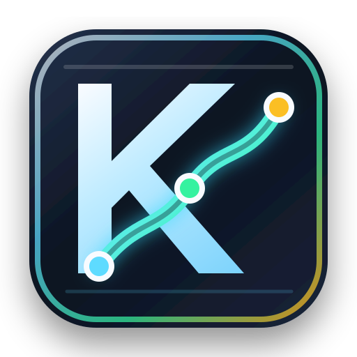
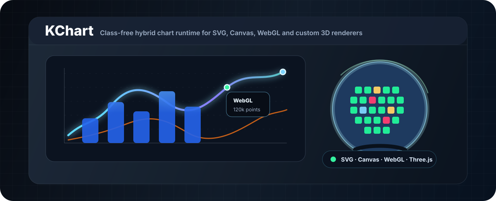
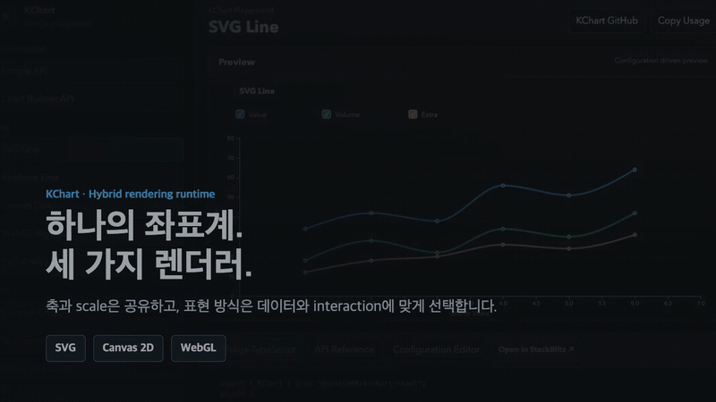

<p align="center">
  
</p>

<h1 align="center">KChart</h1>

<p align="center">
  <strong>TypeScript chart runtime combining SVG, Canvas, and WebGL for custom and large-data visualization.</strong><br />
  하나의 class-free 코어에서 표준 차트, 대용량 데이터, 직접 만든 renderer를 같은 축과 scale 위에 조합합니다.
</p>

<p align="center">
  <a href="https://www.npmjs.com/package/@keneth80/k-chart"></a>
  <a href="https://github.com/keneth80/k-chart/actions/workflows/ci.yml"></a>
  <a href="https://github.com/keneth80/k-chart/blob/main/LICENSE"></a>
  <a href="https://github.com/keneth80/k-chart/releases"></a>
</p>

<p align="center">
  <code>SVG</code> · <code>Canvas 2D</code> · <code>WebGL</code> · <code>Custom Series</code>
</p>

<p align="center">
  <a href="https://k-chart-playground.vercel.app/"><strong>Open Playground</strong></a>
  ·
  <a href="#quick-start"><strong>Quick Start</strong></a>
  ·
  <a href="https://www.npmjs.com/package/@keneth80/k-chart"><strong>npm</strong></a>
  ·
  <a href="https://stackblitz.com/fork/github/keneth80/k-chart/tree/main/examples/stackblitz-simple-api-basic?title=KChart%20Simple%20API&file=src/main.ts"><strong>Run in StackBlitz</strong></a>
</p>

<p align="center">
  
</p>

## Why KChart?

- **Hybrid rendering**: SVG, Canvas, and WebGL series share one chart runtime, layout, axes, and scales.
- **Large-data visualization**: WebGL renderers, pixel-column min/max or LTTB downsampling, and optional worker rendering keep dense line and point views practical.
- **Custom visualization**: `createCustomSeries(...)` exposes resolved scales, plot geometry, and drawing layers without requiring class inheritance.
- **Optional integrations**: React, Three.js, MapLibre, and Cesium live in separate packages or guides, so the core package stays focused.

Choose SVG for standard charts and DOM interaction, Canvas or WebGL for denser data, and Custom Series when the visualization itself is domain-specific.

## Install

```bash
npm install @keneth80/k-chart
```

## Quick Start

Add a container:

```html
<div id="chart" style="width: 100%; height: 420px"></div>
```

Create a line chart with the preset API. `createLineChart(...)` renders immediately and returns a controller for later updates or cleanup.

```ts
import { createLineChart } from '@keneth80/k-chart';

type SalesPoint = {
    month: string;
    revenue: number;
};

const data: SalesPoint[] = [
    { month: 'Jan', revenue: 42 },
    { month: 'Feb', revenue: 48 },
    { month: 'Mar', revenue: 45 }
];

const chart = createLineChart<SalesPoint>({
    selector: '#chart',
    data,
    x: { field: 'month', type: 'point', title: 'Month' },
    y: { field: 'revenue', type: 'number', title: 'Revenue' },
    title: 'Monthly Revenue'
});

// Later: chart.updateData(nextData); chart.destroy();
```

For direct control over axes, series, layers, and options, continue to the [Advanced Quick Start](#advanced-quick-start) or read the [Functional API Guide](docs/functional-api.md).

## Try In StackBlitz

| Start with | Best for |
| --- | --- |
| [Simple Line Preset](https://stackblitz.com/fork/github/keneth80/k-chart/tree/main/examples/stackblitz-simple-api-basic?title=KChart%20Simple%20API&file=src/main.ts) | Small, editable first example |
| [WebGL Line](https://stackblitz.com/fork/github/keneth80/k-chart/tree/main/examples/stackblitz-webgl-line-basic?title=KChart%20WebGL%20Line&file=src/main.ts) | Dense line rendering |
| [Custom Topology](https://stackblitz.com/fork/github/keneth80/k-chart/tree/main/examples/stackblitz-topology-basic?title=KChart%20Topology&file=src/main.ts) | Domain-specific Custom Series |
| [World Activity Map](https://stackblitz.com/fork/github/keneth80/k-chart/tree/main/examples/stackblitz-world-activity-map?title=KChart%20World%20Activity%20Map&file=src/main.ts) | SVG map visualization |

[View all example projects](examples/) · [Explore the live playground](https://k-chart-playground.vercel.app/)

## Hybrid Rendering In 60 Seconds

<p align="center">
  <a href="https://raw.githubusercontent.com/keneth80/k-chart/main/docs/promotion/kchart-hybrid-rendering-60s-ko.mp4">
    
  </a>
</p>

<p align="center">
  <a href="https://raw.githubusercontent.com/keneth80/k-chart/main/docs/promotion/kchart-hybrid-rendering-60s-ko.mp4"><strong>Watch the 60-second video</strong></a>
  ·
  <a href="docs/promotion/hybrid-rendering-ko.md"><strong>Read the Korean technical article</strong></a>
</p>

## Architecture

KChart separates chart coordination from visual rendering. The core resolves axes, scales, layout, interaction, and shared drawing layers; each series is a function that renders into SVG, Canvas, or WebGL with that shared context.

```text
createKChart(configuration)
  -> core: layout, axes, scales, interaction, lifecycle
  -> series: SVG | Canvas 2D | WebGL | custom renderer
  -> options: guide lines, spec areas, cursor, range navigator, notes
  -> controller: render, updateData, resize, destroy
```

The public runtime is class-free. Presets such as `createLineChart(...)` and the fluent `chartConfig(...)` builder produce the same underlying configuration as direct composition.

KChart also includes business-oriented series for relationship, hierarchy, composition, and flow analysis:

- `createGraphSeries(...)` for source-target networks.
- `createTreeSeries(...)` for parent-child structures.
- `createTreemapSeries(...)` for part-to-whole comparison.
- `createSankeySeries(...)` for weighted process flows.

See the [Functional API Guide](docs/functional-api.md) for package boundaries, concrete imports, and the complete extension model.

## Advanced Quick Start

Use the core API when a chart needs multiple series, explicit axes, or custom behavior.

```ts
import {
    createKChart,
    createGuideLineOption,
    createLineSeries
} from '@keneth80/k-chart';

type MetricPoint = {
    time: Date;
    value: number;
};

const chart = createKChart<MetricPoint>({
    selector: '#chart',
    data: [
        { time: new Date('2026-01-01T00:00:00Z'), value: 42 },
        { time: new Date('2026-01-01T01:00:00Z'), value: 48 }
    ],
    axes: [
        { field: 'time', type: 'time', placement: 'bottom' },
        { field: 'value', type: 'number', placement: 'left' }
    ],
    series: [
        createLineSeries({
            selector: 'value',
            xField: 'time',
            yField: 'value',
            color: '#0ea5e9'
        })
    ],
    options: [
        createGuideLineOption({
            y: [{ value: 45, label: 'Target' }]
        })
    ]
}).render();

// chart.updateData(nextData);
// chart.destroy();
```

## Choose A Renderer

| Renderer | Use it when | Typical series |
| --- | --- | --- |
| SVG | Data is moderate and DOM interaction or crisp labels matter most | Line, area, column, pie, graph, tree, map |
| Canvas 2D | Marks are dense and immediate-mode drawing is a good fit | Line, point, candlestick, custom overlays |
| WebGL | Lines or points are very large, frequently updated, or zoomed | Large line and point series |
| Custom Series | The domain needs its own visual grammar | Topology, operations views, specialized diagrams |

Dense line charts can use pixel-column min/max or LTTB downsampling. Canvas line rendering can also run through an OffscreenCanvas worker when supported. Configuration details, lifecycle rules, and fallback behavior are documented in the [Functional API Guide](docs/functional-api.md) and [Configuration Reference](docs/configuration-reference.md).

## Optional Integrations

Optional integrations stay outside the core dependency graph and are included only when the application imports them.

| Integration | Package or guide | Purpose |
| --- | --- | --- |
| React / Next.js | [`@keneth80/k-chart-react`](https://www.npmjs.com/package/@keneth80/k-chart-react) and [integration guide](docs/react-nextjs.md) | Component lifecycle, updates, and cleanup |
| Three.js | [`@keneth80/k-chart-three`](packages/k-chart-three/README.md) | 3D scenes using the Custom Series context |
| MapLibre | [`@keneth80/k-chart-maplibre`](packages/k-chart-maplibre/README.md) | Interactive vector maps and chart overlays |
| Cesium | [`@keneth80/k-chart-cesium`](packages/k-chart-cesium/README.md) | 3D globe and geospatial visualization |

## Features And Guides

- **Presets and builder**: start with `createLineChart(...)`, `createColumnChart(...)`, `createPieChart(...)`, or `chartConfig(...)` in the [Functional API Guide](docs/functional-api.md).
- **Built-in series**: line, area, column, bar, candlestick, pie, doughnut, scatter, bubble, histogram, box plot, gauge, waterfall, graph, tree, treemap, Sankey, globe, and more are indexed in the [examples directory](examples/).
- **Interaction and annotation**: zoom/pan, cursor guides, guide lines, spec areas, tooltip notes, and range navigation are covered by the [Configuration Reference](docs/configuration-reference.md).
- **Large data**: WebGL, min/max and LTTB downsampling, OffscreenCanvas workers, and controller updates are documented in the [Functional API Guide](docs/functional-api.md).
- **Custom rendering**: use `createCustomSeries(...)` for SVG, Canvas, WebGL, Three.js, or mixed-renderer views. Custom tooltip hit testing is documented with the API.
- **AI-assisted integration**: start with the [AI Agent Guide](docs/ai/agent-usage.md) or give an agent [`llms.txt`](llms.txt) for a compact API map.

## Development

```bash
npm ci
npm run ci:adapters
npm run dev
```

The demo runs at `http://127.0.0.1:9003/`. Before opening a pull request, run the validation commands in [CONTRIBUTING.md](CONTRIBUTING.md).

## Project Resources

- [Functional API Guide](docs/functional-api.md)
- [Configuration Reference](docs/configuration-reference.md)
- [React And Next.js Guide](docs/react-nextjs.md)
- [Architecture And Refactor Plan](docs/refactor-plan.md)
- [Code Graph Handoff](docs/code-graph-handoff.md)
- [Release Guide](docs/release.md)
- [Examples](examples/)
- [Changelog](CHANGELOG.md)
- [Contributing](CONTRIBUTING.md)
- [Security Policy](SECURITY.md)
- [GitHub Releases](https://github.com/keneth80/k-chart/releases)

## License

MIT. See [LICENSE](LICENSE).
